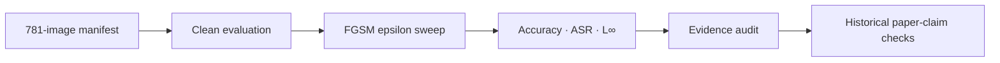

# PaulGuard — Maritime AI Security Research

**Historical project name: AdversarialAI Security. Submitted title: 자율운항선박 이미지 분류 모델 적대적 AI 검증.**

[한국어](README.md) | **English**

**A reproducible research project on adversarial robustness in ship-image classification.** CNN and MobileNetV2 are evaluated on clean images, bounded FGSM perturbations, and fixed preprocessing filters, with traceable saved evidence and explicit reproduction limits.

[MARIS virtual lab](https://maritime-adversarial-lab.hc24734503.chatgpt.site/) · [Repository](https://github.com/heechan9/AdversarialAI_Security) · [Quick start](#quick-start) · [Evidence and results](#evidence-and-results) · [Research boundaries](#research-boundaries)

> Research prototype. MARIS replays stored results; it is not real-time model inference, autonomous-vessel control, a production protection system, or proof of generalized defense effectiveness. External independent reproduction remains FAIL.

<a href="https://maritime-adversarial-lab.hc24734503.chatgpt.site/">

</a>

*Original project artwork, preserved from the Korean README. It illustrates the research theme, not a deployed maritime protection capability.*

[](https://maritime-adversarial-lab.hc24734503.chatgpt.site/)
[](https://github.com/heechan9/AdversarialAI_Security/actions/workflows/iterative-attacks.yml)


[](docs/STAGE_B_HYEONSU_01_REVIEW.md)


The static verification badges describe recorded checks, not a fresh test of the latest main. CPU CI covers synthetic regression and public saved-evidence checks, not complete GPU experiments, new inference on the private 781-image set, or independent approval. The 9/9 claim audit concerns the historical v1.5 snapshot, not the latest manuscript in full. [CPU CI scope and commit-specific review](docs/CPU_CI_REVIEW.md).

**2026 Smart Maritime Logistics × ICT Mentoring**

This English overview follows the Korean README's research evidence and retains its two original visual assets. Many linked technical records and text inside the original artwork remain in Korean. Current integration updates below are distinguished from historical checks. This is a repository overview, not an English final technical report.

## At a glance

A model can classify an unmodified ship photograph correctly and change its prediction after a bounded pixel perturbation. This project measures that behavior and checks whether reported numbers agree with the underlying records.

- Clean baselines use the same 781-image test set for CNN and MobileNetV2.
- FGSM is an untargeted, single-step attack with a checked perturbation budget.
- ASR uses only images correctly classified before attack, avoiding an inflated denominator claim.
- Auditors cross-check CSV, JSON, manifests, model hashes, and documentary claims.
- The confirmed FGSM sweep is **ε = 0, 0.01, 0.03, 0.05**. Clean/FGSM and fixed 3×3 Gaussian/mean-filter comparisons have recorded experiments and evidence audits. Historical `provisional` and `experimental` labels remain intact; they do not mean the epsilon range is undecided.

Small L∞ alone does not prove human imperceptibility. See the [maritime-practice comparison](docs/MARITIME_PRACTICE_GAP_REVIEW.md) for the gap between this experiment and operational maritime video systems.

## Current research and integration status

**Main checked October 30, 2026:** [`08b33ae04248798de76cebba2e7d242d134d28c7`](https://github.com/heechan9/AdversarialAI_Security/commit/08b33ae04248798de76cebba2e7d242d134d28c7). The public display name is **PaulGuard**; the submitted title, team contributions, repository URL and MARIS interface name are preserved. Older main SHAs and test counts below are dated historical records.

- **Submission preparation on main:** [#99](https://github.com/heechan9/AdversarialAI_Security/pull/99) integrated pre-submission use checks, screenshot evidence and Hyeonsu's cross-only handoff preparation. Comparing 72 display conditions on the then-deployed v16 checked saved-result presentation, not new model experiments. This does not establish final submission, physical-phone validation or independent model reproduction.
- **Later support receipt remains a separate Draft:** [#101](https://github.com/heechan9/AdversarialAI_Security/pull/101), head `f65d0398a1967a2f3ed763f02de12f0405acb1eb`, records 783 matching submitted-JSON asset entries for two models and 781 images. `model_inference_performed=false`; selected cross-only remains **INCOMPLETE**. “Return unavailable” below describes the earlier checkpoint in main's integration record, not absence of that subsequent asset-check receipt. Asset matching is not full reproduction PASS. Research-PC LOCAL_PASS, external FAIL and the unresolved cause are retained.
- **Documentation awaiting review:** [#102](https://github.com/heechan9/AdversarialAI_Security/pull/102), head `1815bb159f7ffa3a75b85086fa3e666ca1692183`, covers controlled comparison/review handoff; [#103](https://github.com/heechan9/AdversarialAI_Security/pull/103), head `9063a29229855cdc5f35af59adb204a8d61b721b`, covers international collaboration. Both are separate open Drafts. Updating this README's display name does not merge those documents or establish a partnership or independent review.
- **Use and interpretation:** compare **saved results** by model, epsilon and filter in [MARIS](https://maritime-adversarial-lab.hc24734503.chatgpt.site/), then follow [Quick start](#quick-start) for reproduction scope. Keep FGSM, separate PGD/training experiments and different clean-correct ASR denominators apart. One seed's **6.15%** PGD50/5-restart accuracy and **+0.90 pp** over clean-only continued training describe that internal condition, not general defense guarantees or real-vessel safety.

### Dated integration and experiment history

**October 26, 2026 — submission preparation:** The [code/evidence integration record](docs/reviews/20261026/final_submission_integration.md) confirms the existing Taehee October 23 handoff (#92) and Jaehyeok saved-evidence review (#88), and connects Giho's October 24 presentation review. Hyeonsu's October 21 selected cross-only support return is not available (`INCOMPLETE`). A [byte-exact input preparation correction and handoff](docs/HYUNSU_CROSS_ONLY_HANDOFF_20261026.md) address the packet's selection-hash mismatch. This is not fresh inference, full reproduction approval, or confirmation that the final report has been updated. Dated records and the external FAIL remain intact.

**October 24, 2026 — separate follow-up:** The [matched CNN result package](results/extensions/matched_cnn_20261024/README.md) records one seed (2026), 781 test images per model. Mixed training versus clean-only improves PGD7 by 7.43 pp and PGD50/5 restarts by 0.90 pp (7 net correct); strong-attack accuracy remains 6.15%. Only one of three planned training seeds has run. These results are separate from historical paper metrics and the external Stage B FAIL; they are not independent reproduction approval or general defense validation. Executed training code is pinned to unmerged Draft #87.

Checked on October 23, 2026: main is [`362bfbd768d71eed4a07f535bd50ebb697174ce2`](https://github.com/heechan9/AdversarialAI_Security/commit/362bfbd768d71eed4a07f535bd50ebb697174ce2), after [#93](https://github.com/heechan9/AdversarialAI_Security/pull/93). This README preparation does not rerun models, publish a deployment, or establish completion of the whole project or final report.

- **Paired defense review on main:** #93 adds descriptive analysis of the existing predictions and its MARIS panel. The 16 model/epsilon/filter conditions and 160 class groups reuse the same 781 image identities. They are not independent new samples or new model-performance experiments. [Method and limits](research/paired_defense_review/README.md).
- **Taehee's handoff record:** [#92](https://github.com/heechan9/AdversarialAI_Security/pull/92) adds the receipt/review record and scoped contribution documentation for a fixed-baseline CPU handoff. It does not establish completion of all second-round work, fresh private-model inference, latest-manuscript review, or external independent reproduction. [Receipt and verification boundaries](docs/reviews/20261023/taehee_cpu_handoff_review.md).
- **Team integration history:** The October 26 record above now connects Giho's submitted presentation review; final adoption and re-rehearsal are not established. Hyeonsu's new selected cross-only return remains unavailable. Existing Hyeonsu Stage B evidence below is historical evidence, not completion of that support. The final report must not be described as fully updated or complete.
- **Unmerged work:** [#86](https://github.com/heechan9/AdversarialAI_Security/pull/86) covers interrupted FGSM runs and missing-condition auditing; [#87](https://github.com/heechan9/AdversarialAI_Security/pull/87) covers a matched clean-only training control and paired audit. Branch checks are not main integration or completed new paired training. [#78](https://github.com/heechan9/AdversarialAI_Security/pull/78) remains a separate unfinished GPU-extension Draft.
- **Saved-evidence review:** [#88](https://github.com/heechan9/AdversarialAI_Security/pull/88) integrated [claim review](docs/reviews/20261019/evidence_claim_review.md), [numeric recalculation](docs/reviews/20261019/evidence_calculation_review.md), and [review methods](docs/reviews/20261019/evidence_review_method.md). Preparation, AI assistance, subsequent organization, and independent model reproduction are different contributions.
- **Historical CI:** [b92ba8f CPU CI](https://github.com/heechan9/AdversarialAI_Security/actions/runs/39568046992) recorded 780 passed / 18 warnings. This dated saved-evidence/synthetic-regression result is not a test count for the current main or evidence of improved model performance.

### Reproduction status: do not collapse these outcomes

| Verification | Status | Confirmed scope |
|---|---|---|
| [Research-PC full rerun](docs/STAGE_B_PC_FULL_20260928.md) | LOCAL_PASS | Two models × 781 images × two filters × four epsilons; predicted labels and summary metrics matched. Probability values were not compared. |
| [External independent rerun](docs/STAGE_B_HYEONSU_01_REVIEW.md) | FAIL | 16 differing prediction cells across 14 images in the preserved evidence. Mean-filter execution was auxiliary diagnosis, not a passing full external run. |

| Tracked issue | Status | Recorded history |
|---|---|---|
| Cross-environment MobileNetV2 prediction mismatch | Unresolved | Two recorded issues; see the verification documents |

The external run used the existing evaluator, not an independently implemented algorithm. Subsequent Linux inference reproduced Hyeonsu's predictions across all eight Gaussian conditions. Targeted diagnosis covered **14 images / 16 prediction cells**: disabling oneDNN shifted 11 cells to reference predictions, but the original cause of the remaining **5 cells / 4 images** remains unconfirmed. A separate control demonstrated numerical sensitivity during attack generation; this does not establish one universal cause.

The research PC's targeted follow-up matched those remaining five reference predictions, and the full rerun completed on September 28 matched 16 CSVs of 781 rows against execution commit `b86f725`: 62,480 predicted labels plus summary metrics, excluding probabilities. The evidence was received on October 1. Historical environment equivalence was not established. Neither local match resolves the external FAIL. [Targeted PC diagnosis](docs/STAGE_B_PC_FOLLOWUP_20260928.md) · [Local follow-up](docs/STAGE_B_LOCAL_FOLLOWUP.md) · [Tensor traces](docs/STAGE_B_TENSOR_TRACE.md) · [Original-environment collection](docs/STAGE_B_ORIGINAL_ENVIRONMENT.md).

[Comparator correction #54](https://github.com/heechan9/AdversarialAI_Security/pull/54) collects label/summary differences across conditions instead of ending mean-filter evaluation at a Gaussian mismatch. Structural/contract violations still fail immediately; final mismatch remains FAIL with a nonzero exit code. Existing values and tolerances were not relaxed.

## How the evidence pipeline works


1. Measure clean classification on 781 images.
2. Generate one-step FGSM perturbations within the declared budget.
3. Compare attacked accuracy, accuracy drop, attack success rate, and maximum perturbation.
4. Audit source records against summaries and documents; inconsistent or tampered evidence produces a failing exit code.

*This original pipeline illustration explains the research workflow. It does not depict live vessel control or integration with a port operating system.*

| Research stage | Status | Confirmed scope |
|---|---|---|
| Clean baseline | Verified | CNN and MobileNetV2, 781 test images |
| FGSM implementation | Verified | Gradient direction, input clipping, L∞ bound, epsilon-zero control |
| FGSM metrics | Experiments and saved-evidence audit recorded | ε = 0, 0.01, 0.03, 0.05; original status labels retained |
| Research evidence audit | Verified within scope | Manifest, model-hash metadata, CSV/JSON/document consistency, visual-review evidence |
| Stage A recalculation | Complete | Recalculation of stored Clean results, not fresh original-model inference |
| Stage B original-model rerun | Execution confirmed; result agreement FAIL | External mismatch remains; original cause of five cells/four images unconfirmed |
| Research-PC full rerun | LOCAL_PASS | Labels and summary metrics for the full declared matrix; probabilities excluded |
| Paper claim audit | 9/9 historical claims passed | v1.5 snapshot only, not the latest manuscript in full |
| Gaussian/mean preprocessing | Experiments and saved-evidence audit recorded | Fixed 3×3 filters, transfer FGSM and defense-aware FGSM |
| MARIS virtual lab | Implemented; source integrated | Explanatory 3D interaction, stored-image comparison, saved-result replay; no live inference |
| BIM/PGD/JSMA/adversarial training | Condition-specific complete, partial, and unfinished work | CNN study completed within its stated scope; other conditions remain partial/unfinished |
| VLM/LLM and safety-impact simulator | Future expansion | Outside the current paper experiment scope |

## Evidence and results

### Clean accuracy is not adversarial robustness

| Model | Correct predictions | Accuracy | Rounded interpretation |
|---|---:|---:|---|
| CNN | 504 / 781 | 0.6453264951705933 | About 64.5% |
| MobileNetV2 | 613 / 781 | 0.7848911881446838 | About 78.5% |

MobileNetV2 correctly classified 109 more images. Both models had relatively weak Sailboat and DDG recall before attack, so class-specific weaknesses predate perturbation.

### Bounded FGSM results

These are **preserved experiment results**, checked for CSV/JSON consistency. Original `provisional` paths/status remain; a separate official execution contract's approval/rerun record has not been linked. This does not reopen the agreed epsilon range.

| Epsilon | CNN attacked accuracy | CNN ASR | MobileNetV2 attacked accuracy | MobileNetV2 ASR |
|---:|---:|---:|---:|---:|
| 0.00 | 64.53% | 0.00% | 78.49% | 0.00% |
| 0.01 | 41.61% | 35.52% | 12.42% | 84.18% |
| 0.03 | 24.33% | 62.30% | 13.19% | 83.20% |
| 0.05 | 20.23% | 68.85% | 16.13% | 79.45% |

- **Epsilon** bounds the maximum pixel-value change in normalized input space.
- **Attacked accuracy** uses the entire perturbed test set.
- **ASR** is the fraction of originally correct predictions that become incorrect, using 504 CNN or 613 MobileNetV2 clean-correct images as the denominator.
- MobileNetV2's higher clean accuracy did not prevent 84.18% ASR at ε=0.01 in this experiment.
- Nonmonotonic MobileNetV2 results are observations, not proof of FGSM overshoot.

**Reproduction caveat:** external and subsequent Gaussian reruns yielded 102/781 (13.06%) for MobileNetV2's original attack at ε=0.03, compared with the preserved reference 103/781 (13.19%). The reference table was not overwritten to hide the mismatch. [Clean results](docs/CLEAN_BASELINE_RESULTS.md) · [FGSM results](docs/FGSM_PROVISIONAL_RESULTS.md).

### Preprocessing helps some stored attacks, not all threat models

Fixed 3×3 Gaussian and mean filters improved classification of existing FGSM images, but effectiveness fell substantially against **defense-aware FGSM**, which differentiates through the preprocessing. Clean accuracy decreased for CNN and increased for MobileNetV2. Both effects matter.

The completed comparison retains `experimental` source labels. Recovery under an existing attack does not establish general defense success or vessel safety. [Gaussian evidence](results/defenses/experimental/gaussian_run_01/README.md) · [Mean-filter evidence](results/defenses/experimental/mean_run_01/README.md) · [Current scope](docs/CURRENT_RESEARCH_STATUS.md) · [Historical Jules audit](https://jules.google.com/session/11380383362183201753).

The [paired review](research/paired_defense_review/README.md) reports wrong→correct and correct→wrong transitions, not just net accuracy. For CNN/Gaussian/ε=0.03, transfer comparison gains 128 and loses 47 images; adaptive comparison gains 36 and loses 128. Transfer→adaptive gains 3 and loses 176. These describe stored outcomes, not new gains produced by this analysis. Own-clean ASRs have separate eligibility sets; the explicitly named common-clean-correct subset uses a shared denominator but is selected, not representative of the whole population. Scene/vessel/session independence is unverified, so McNemar p-values and bootstrap confidence intervals are withheld, not reported as zero. Adaptive and transfer attacks use different perturbations: this is not a causal defense effect under identical attacks.

### Later research is separate from the submitted baseline

The [CNN adversarial-training study](results/extensions/cnn_adversarial_20261002/README.md) used 6,147 training and 689 validation images, then 781 test images. Recorded clean accuracy changed from 64.53% to 69.14%, and PGD7 accuracy from 11.14% to 18.57%. Scope: PGD7, ε=0.03, one restart, no filter. This is not validation under all stronger attacks or independent external reproduction; a matched clean-only control remains separate work.

[Square/SurFree black-box evaluation](results/extensions/blackbox/README_20261003.md) has a separate recorded study. [BIM/PGD follow-up](docs/FOLLOWUP_EXECUTION_STATUS.md) retains partial results; MobileNet training, remaining BIM/PGD conditions, and full JSMA evaluation are not complete. These extensions do not change the submitted reference values or Stage B verdict.

## Technical contract and verification principles



- **Input:** `rescale=1./255`, range `[0,1]`.
- **Attack:** untargeted FGSM, true-label categorical cross-entropy, exactly one step.
- **Equation:** `x_adv = clip(x + epsilon * sign(grad_x L), 0, 1)`.
- **Budget:** `L_infinity <= epsilon + 1e-6`.
- **Zero control:** accuracy drop, ASR, and maximum L∞ are zero at epsilon zero.
- **Tamper detection:** modified canonical evidence or document-number inconsistency yields a nonzero exit.

| Research decision | Work performed | Inspectable evidence | Practical relevance |
|---|---|---|---|
| Clean accuracy alone is insufficient | Apply the same FGSM contract and epsilon sweep to two models | Per-image CSV, summary JSON, model reports | Robustness evaluation |
| ASR denominator can mislead | Use clean-correct eligibility and epsilon-zero controls | Contract, unit tests, mutation tests | Fair metrics and quality assurance |
| Documents can drift from results | Cross-check manifests, hashes, CSV, JSON, and documents | Evidence audit and historical 9/9 claims | Traceability and data governance |
| Future goals can be mistaken for implementation | Separate completed FGSM evidence from later attack/model plans | Scope and result records | Responsible technical communication |

Heechan Choi defined the research scope and audit requirements, checked integrity/reproduction/tests with original images and local model binaries in Windows, and coordinated result review and repository integration. Human work, AI assistance, implementation, and review are distinguished in [CONTRIBUTIONS.md](CONTRIBUTIONS.md).

| Audit target | Method |
|---|---|
| Test data | Validate ordering, structure, and SHA-256 manifest for 781 files |
| Models | Compare CNN/MobileNetV2 metadata with local binary SHA-256 when available |
| Clean results | Recalculate correct counts and accuracy from prediction CSVs |
| FGSM results | Recalculate accuracy, ASR, and L∞ from per-epsilon sample CSVs |
| Documentary claims | Cross-check README/results/claims against canonical CSV and JSON |
| Tamper resistance | Mutation tests change values, denominators, hashes, manifests, and documents |

Without the original images and `.h5` models, a clean checkout records the relevant binary-content checks as `UNAVAILABLE`, not PASS. A saved-evidence audit is not new model inference.

## MARIS virtual lab

[Open MARIS](https://maritime-adversarial-lab.hc24734503.chatgpt.site/) · [Web source and execution guide](web/maris/README.md)

MARIS provides explanatory 3D interaction, stored clean/attack-image comparison, saved-result exploration, verification status, and the paired defense review. The separately confirmed deployment is version 16; this README-only change does not deploy or revalidate the live site. No new screenshot or English-localized artwork is claimed here. The original two project visuals above are preserved, rather than presented as live browser captures.

## Quick start

Read the [reproducibility guide](docs/REPRODUCIBILITY.md) and [CPU CI scope](docs/CPU_CI_REVIEW.md) first. The recorded research-PC full rerun is already LOCAL_PASS; repeating it is not required to read or audit saved results. Consult [PC follow-up evidence](docs/STAGE_B_PC_FOLLOWUP_20260928.md) before repeating targeted diagnosis. Do not install or upgrade packages in an original environment that needs to be preserved for diagnosis.

General development and saved-result auditing:

```bash
pip install -r requirements.txt
export PYTHONPATH=src

python -m pytest -q
python scripts/audit_research_evidence.py
python scripts/audit_paper_claims.py
```

Windows CMD, from your repository checkout:

```bat
conda activate adversarial_ai
set PYTHONPATH=src

python -m pytest -q
python scripts\audit_research_evidence.py
python scripts\audit_paper_claims.py
```

The research-evidence auditor checks available data/model evidence, Clean/FGSM records, and documents. The claim auditor recalculates nine historical claims. Successful checks return exit code 0; missing required evidence, tampering, or contract violations return exit code 1. These commands do not guarantee an independent reproduction PASS.

## Repository structure

| Path | Role |
|---|---|
| `configs/` | Classes, test manifest, experiment configuration |
| `src/adversarial_ai/` | Attack, evaluation, integrity, and audit package |
| `scripts/` | Audit and experiment entry points |
| `tests/` | Contract, integrity, and tamper-detection tests |
| `results/clean/` | Canonical Clean results |
| `results/attacks/provisional/` | Preserved FGSM results before separate official promotion |
| `results/audit/` | Research-evidence audit reports |
| `docs/` | Scope, contracts, results, and reproduction records |
| `research/paired_defense_review/` | Descriptive paired analysis of existing predictions |
| `web/maris/` | MARIS application source |

## Documentation guide

| Document | Contents |
|---|---|
| [Project scope](docs/PROJECT_SCOPE.md) | Completed scope, decision gates, future research |
| [Experiment contract](docs/EXPERIMENT_CONTRACT.md) | Inputs, FGSM, metrics, reproduction criteria |
| [Clean results](docs/CLEAN_BASELINE_RESULTS.md) | Baselines and class-specific limits |
| [FGSM results](docs/FGSM_PROVISIONAL_RESULTS.md) | Epsilon-specific results and interpretation limits |
| [Reproducibility](docs/REPRODUCIBILITY.md) | Data/model placement and execution |
| [Research-evidence audit](docs/RESEARCH_EVIDENCE_AUDIT.md) | Audit scope, status, CLI |
| [Paper-claim audit](docs/PAPER_CLAIM_AUDIT.md) | Nine historical claims and canonical evidence |
| [Integration review](docs/INTEGRATION_REVIEW.md) | Integration scope, checks, remaining local work |
| [Official-candidate runbook](docs/FGSM_OFFICIALIZATION_RUNBOOK.md) | Approval contract, run ID, candidate audit |
| [Independent verification](docs/INDEPENDENT_VERIFICATION.md) | Stage A and unresolved Stage B agreement |
| [Hyeonsu Stage B review](docs/STAGE_B_HYEONSU_01_REVIEW.md) | Submitted evidence integrity and prediction differences |
| [Tensor traces](docs/STAGE_B_TENSOR_TRACE.md) | Numerical sensitivity and remaining five-cell limits |
| [Original-environment collection](docs/STAGE_B_ORIGINAL_ENVIRONMENT.md) | Environment capture and return procedure |
| [Maritime threat model](docs/THREAT_MODEL.md) | Classification experiments versus operational impact |
| [Plymouth research alignment](docs/PLYMOUTH_RESEARCH_ALIGNMENT.md) | Related work and extension boundaries |
| [Visual-review audit](docs/VISUAL_REVIEW_AUDIT.md) | Candidate selection and visual-review evidence |
| [Causal safety validation](docs/CAUSAL_SECURITY_VALIDATION.md) | Classification vulnerability versus operational harm |
| [Role alignment](docs/ROLE_ALIGNMENT.md) | Implementation evidence and claim limits |
| [Trained black-box protocol](docs/TRAINED_BLACKBOX.md) | Square seeds, SurFree adapter, query accounting |
| [Black-box results](results/extensions/blackbox/README_20261003.md) | Fixed-set self-run evaluation and limits |
| [Contribution record](CONTRIBUTIONS.md) | Human/AI roles and verification principles |

## Research boundaries

- Confirmed FGSM experiments and saved-record audits are distinct from separate official execution approval and external reproduction.
- CNN uses 128×128 inputs; MobileNetV2 uses 224×224. MobileNetV2's original training preprocessing, split ratio, and random seed remain unconfirmed.
- Filter recovery on transferred attacks is not generalized robustness. Report defense-aware attacks and clean-performance changes together.
- Later training and iterative/black-box studies have their own conditions. Do not claim the entire BIM/PGD/JSMA/training/transfer-attack program is complete.
- The same 781 images recur across conditions. Hashes do not establish scene/vessel/session independence or leakage-free generalization.
- Classification degradation has not been causally linked here to collision, route deviation, or other operational harm.
- VLM/LLM evaluation and safety-impact simulation remain future goals, not current implementation achievements.
- Paper submission, latest manuscript review, team-work integration, and final-report completion are separate states. The [paper release record](docs/PAPER_RELEASE_STATUS.md) distinguishes them. The user confirmed submission on October 1; a receipt/submission identifier was not independently verified. Manuscript binaries are not published here.

## Contributing

Read [CONTRIBUTIONS.md](CONTRIBUTIONS.md). Preserve original outputs, distinguish source execution from saved-output recalculation, report exact commits and denominators, and state limitations alongside results. Do not add private input images, model binaries, original handoff archives, or manuscript files as part of this README work.

**Reproducible experiments, traceable numbers, and conclusions that do not overclaim.**

