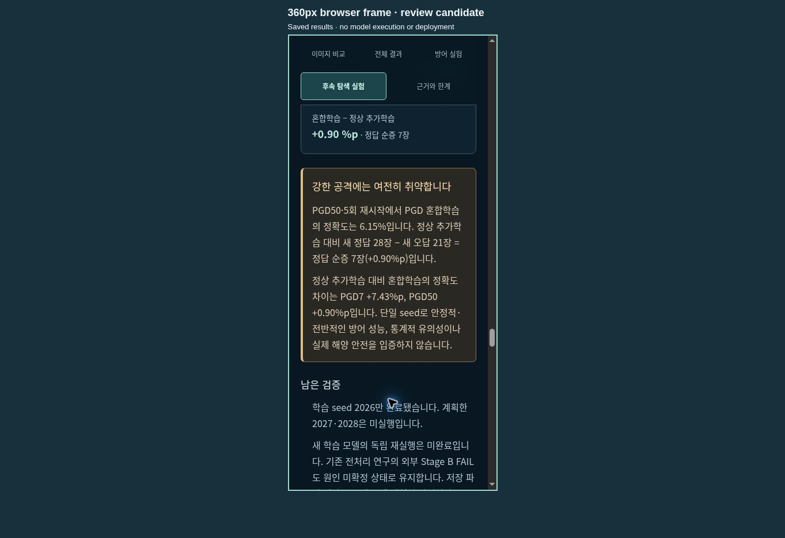

# Calculated follow-up warnings and 360px review

This review candidate follows merged #96 (`efbe0cf`). It changes presentation
calculations and tests only. The original result JSON, CSVs, model metadata,
October 12 panel and existing reproduction limits are unchanged. No model
training/inference, merge or deployment occurred in this task.

## Calculation contract

Both Korean and English warning paragraphs use the same calculations as the
cards, reading the public `matched-cnn-followup.json`:

- Accuracy = model correct count / model sample count × 100.
- Accuracy difference in percentage points = (mixed correct / mixed samples −
  clean-only correct / clean-only samples) × 100.
- Net correct difference = paired newly correct − paired newly incorrect.
- Newly correct and newly incorrect are the JSON's audited paired counts.
- The warning's PGD50 restart count also comes from JSON settings.

For the retained evidence this yields PGD50 6.15%, 28−21=7 net correct,
+0.90 pp; PGD7 +7.43 pp. These performance values are no longer literal
numbers in the warning's Korean/English source strings. Both changes are stated
numerically rather than hardcoding an improvement direction. Negative and zero
differences retain the correct sign; Korean uses 순감 for a negative net count.

## Automated checks

- Eight actual condition/language renders check the full warning paragraph and
  the two calculated differences in both languages.
- Twenty-four additional synthetic renders (three scenarios × two languages ×
  four condition choices) change JSON counts in memory only. Positive, negative
  and zero differences are covered. Cached `accuracy`, `net_correct` and
  `percentage_points` fields deliberately retain their original values, so the
  test rejects warnings/cards that use those stale summaries or old literals.
  These synthetic numbers are test fixtures, not experimental results.
- Existing saved-evidence hashes, deterministic export and unchanged October 12
  panel checks pass. The public JSON and source CSV files have no diff.
- TypeScript, lint, existing UI/evidence suites and managed local build pass.
  Lint retains the original image warning; server-render chart-size warnings
  and existing build chunk/static-classification warnings remain documented by
  the prior review. Remote CI results belong to the exact PR head.

## 360px Chrome browser check

The actual candidate was loaded in an internal 360px-wide iframe (345px content
area after the desktop scrollbar). This is a browser layout check, not a test
on physical mobile hardware.

- Korean/English × all/clean/PGD7/PGD50: eight UI combinations. All shows three
  cards; each individual condition shows one. The calculated warning stays
  visible and agrees with the recorded metrics in both languages.
- Document scroll width equals content viewport width: 345px in both
  languages. The existing narrow-screen contents-menu wrap is preserved.
- Keyboard End/Enter selects PGD50; switching to Korean retains PGD50.
- Keyboard Home/ArrowDown/ArrowDown/Enter selects PGD7. Tab reaches the provenance
  summary, Enter expands it, and switching to English retains both PGD7 and the
  expanded disclosure. Pointer-independent keyboard interaction remains usable.
- Existing single-seed/unrun-seed/Stage B FAIL limits remain on screen.

Actual phones, touch hardware and screen readers remain unverified. Screenshot
capture initially timed out using a clipped capture; the documented full-view
capture succeeded. The temporary QA wrapper is excluded from the PR.

