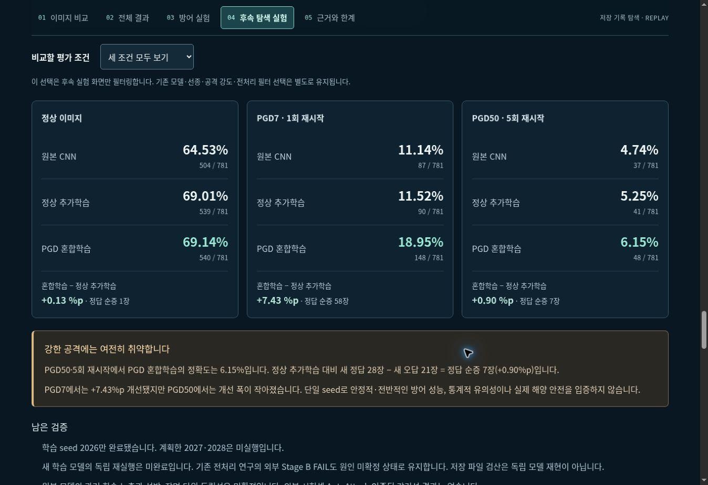
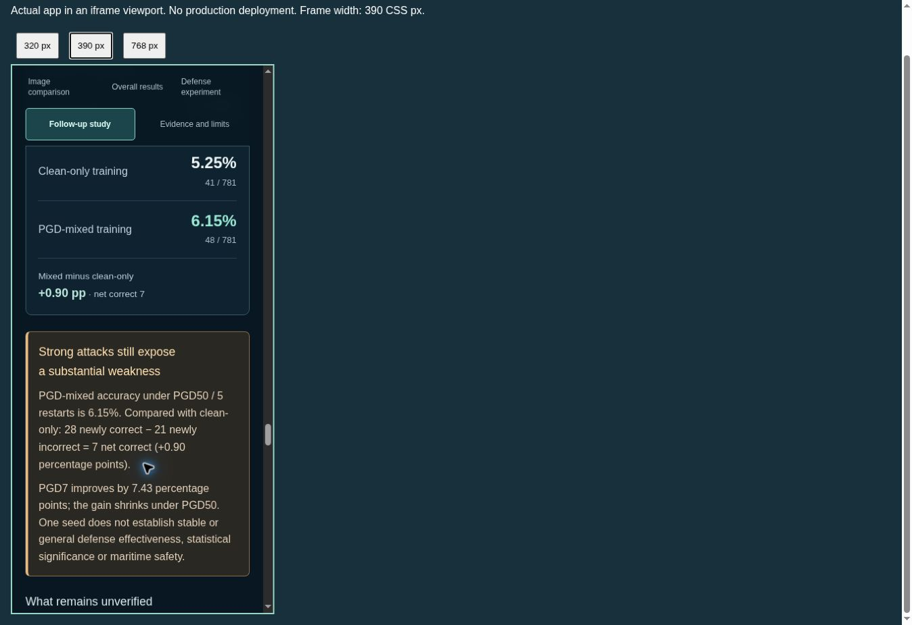

# Matched CNN follow-up UI review candidate — 2026-10-24

The new MARIS `#followup` section presents #95 as a **follow-up exploratory
experiment**, separate from historical paper results and the October 12 panel.
This candidate is for review before merge/deployment. No model training,
inference, data/model sharing changes or production deployment occurred in this
UI task.

## Display and evidence

- Three checkpoints are compared within each recorded condition: clean, PGD7
  (one restart), PGD50 (five restarts). All are unfiltered CNN test results,
  781 images per model, training seed 2026; ε=.03 for both attacks.
- The PGD50 caveat stays visible for every selector value: mixed accuracy
  6.15%; 28 newly correct − 21 newly incorrect = 7 net correct (+0.90 pp).
  PGD7 +7.43 pp is not generalized to strong-attack or overall defense success.
- Single-seed limits, unrun seeds 2027/2028, historical-test-set scope,
  unresolved exposure/group independence, incomplete independent replay and
  the original external Stage B FAIL remain explicit in both languages.
- Validation 689-image checkpoint selection is distinguished from the displayed
  781-image test accuracies. The unchanged pre-inference paired-audit flag is
  explained in the expandable provenance section.
- A compact public JSON is exported only after the saved auditor passes and
  input bytes match published commit `13d92a15c3b8953e24b5d44326cd2327973a7a25`.
  Links point to that immutable public result package, raw CSVs, code and
  historical FAIL document. No private Drive/Colab links or model/image bytes
  are added. Existing FGSM image cases are not relabeled as PGD examples.
- The original October 12 JSX panel is byte-for-byte unchanged. Its 18.57%
  historical PGD7 value remains alongside the separate new 18.95% result.
  The retraining notice in the surrounding progress overview now explicitly
  applies to the original FGSM/preprocessing panel; the new study records two
  actually trained arms. No historical numeric file is modified.

## Checks performed

- Standard-library saved-result auditor: PASS; no model inference.
- `pnpm exec tsc --noEmit`: PASS.
- `pnpm run lint`: PASS with the retained image-component warning. The new
  CommonJS SSR harness uses the same narrowly scoped loader-hook exception as
  the existing SSR harnesses; production component rules are unchanged.
- `pnpm run test:evidence`: PASS, including public source-file SHA-256 agreement,
  all displayed metrics against saved CSV recalculation, deterministic export,
  8 condition/language renders and unchanged October 12 panel checks.
- `pnpm run test:ui`: PASS — existing translation, image/3D synthetic controls,
  mission and 352 paired-review render cases. Existing server-render chart-size
  warnings do not constitute browser-layout verification.
- Managed local build: PASS through
  `bash scripts/sites-env.sh -- bash scripts/build-verified.sh`. The ordinary
  `pnpm run build` initially reached an existing non-executable helper; explicit
  Bash invocation uses the same retained helper without changing its tracked
  mode or source. Build warnings about chunk size/static route classification
  remain. There was no deployment.
- Git whitespace check: PASS.

CI's MARIS checkout now requests complete Git history because the public export
and preservation comparison read the pinned #95 commit. Other jobs are unchanged.
Read the PR checks for remote results; these local checks are not independent
experimental approval.

## Browser QA

Actual candidate served through the supported internal preview and inspected
in Chrome, with the real MARIS React page loaded. Responsive checks used an
internal, uncommitted iframe harness; they are browser viewport checks rather
than physical-phone emulation or device tests.

| Frame width | Inner CSS viewport after scrollbar | Korean page scroll width | English page scroll width |
|---|---:|---:|---:|
| 320 px | 305 px | 305 px | 305 px |
| 390 px | 375 px | 375 px | 375 px |
| 768 px | 753 px | 753 px | 753 px |

Measurements above were taken after the rendered language/layout settled.
The five-item contents menu initially overflowed at the narrowest size; it now
wraps onto two rows below 420 px. The follow-up cards and evidence links remain
inside their container.

- 3 widths × 2 languages × 4 selector values = **24 UI combinations** checked.
  All shows three cards; each individual condition shows one. The PGD50 caveat
  and 28/21 counts remain visible in every selection.
- Keyboard Home/ArrowDown/Enter changes the native condition selector; Tab
  reaches the provenance summary; Enter opens it. Focus styling is visible.
- Keyboard and pointer language activation update the interface. The selected
  condition is retained. The English panel has no untranslated Korean copy.
- Existing defense controls were exercised with MobileNetV2 / Gaussian / ε=.01;
  they update the original defense panel and do not alter the new matched-CNN
  cards. Existing Mean/Gaussian data and all original public PNG/JSON hashes pass
  their retained checks.

Actual physical Android/iOS, touch hardware, screen readers, high-contrast mode,
and a complete assistive-technology audit were **not** performed. No screenshot
is evidence of model replay, robustness, or a production release.

## Candidate screenshots

Desktop comparison and strong-attack caveat (Korean):

390 px frame (English): PGD50 accuracy, net difference and caveat. The surrounding
internal QA label is intentional; this is not the deployed public page.

