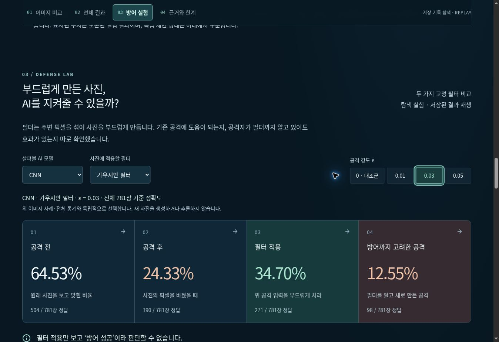
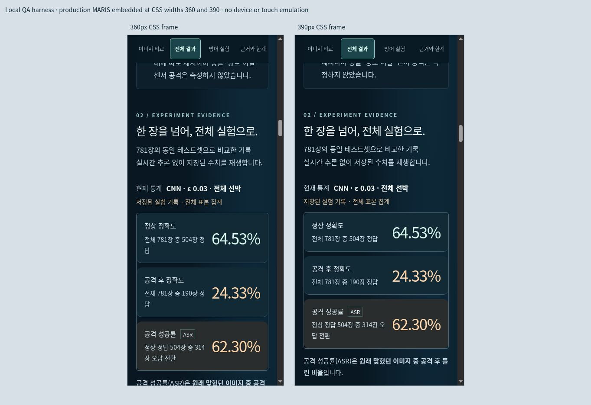

# 제출 직전 실제 사용 점검

2026-10-26 KST. #98 검토와 별도로 수행했다. 확인 시작 시 main은
`d81e816457d0231d0ee8b886890a658011fb1387`, #98은 Draft
`76849fcf69731676f869e7054fa12c9ef0d1a1a7`였다. #98 head를 수정하지 않는다.
이 추가 브랜치는 #98을 부모로 하며 기존 인계 안내의 누락 단계와 이 점검만
추가한다. 새 모델 추론·공격·학습, 새 영상 제작·업로드, 병합·배포·제출은 하지 않았다.

## 확인한 실물과 버전

| 대상 | 식별값 | 확인 범위 |
|---|---|---|
| 공개 MARIS | 버전 16, https://maritime-adversarial-lab.hc24734503.chatgpt.site/ | 실제 브라우저 접속·조작. 버전의 Sites 소스 SHA는 `af9a492ddac2dc16401d622d992b6ea53c8462f1`이며 별도 Sites 저장소의 SHA다. GitHub main SHA로 치환하지 않음 |
| GitHub main | `d81e816457d0231d0ee8b886890a658011fb1387` | 소스/공개 JSON 대조. 10/24 후속 패널 및 #97 표시 개선이 있음. 이번 점검에서는 이 main을 새로 배포하거나 별도 실행하지 않음 |
| 확인한 발표 PDF | `ACK2026_김기호_발표용_20261019.pdf`, SHA-256 `b89e8fa8865d3ffbcd2a0c1c0441cb9d401bbbde2f9e3c355df42a9b1e777601` | 15쪽(본문14+보충1), 본문 텍스트와 5·6·10·12·13·14쪽 렌더 화면 확인 |
| PPTX | `ACK2026_김기호_발표용_20261019.pptx`, SHA-256 `7d349ed9261963d75e5c6ef03e3264d12c3536a84a4f9db826f341dd47f3c206` | 슬라이드15개·발표자 노트15개, 아래 W1~W3의 실제 포함 여부 확인. PowerPoint 앱에서 연 검사는 아님 |
| 발표 원고 | `ACK2026_김기호_슬라이드별_발표대본_20261019.docx`, SHA-256 `c4980340059168be8d0290339c9bc55bd8ceab25a5bcda0bb409afcc38ab2a75` | 실제 본문·슬라이드 진행 안내·목표 시간 확인. 최신 제출 대상 확정은 별도 |
| 확인한 연습 영상 | `ACK2026_적대적AI_최종디자인_본문14장_연습용.mp4`, SHA-256 `31911477fea30d28968982d9420e51753d9aef69493a3e09172cbc1e4ff1f588` | 1920×1080, 12fps, 827.25초(13분47.25초), 영상/음성 스트림 존재. 30초 간격28개 프레임에서 본문14개 슬라이드 화면/수치를 확인. 음성·모든 프레임 전수 검수는 아님 |

비공개 발표/원고/영상 원문과 프레임은 공개 Git에 첨부하지 않는다.
확인한 파일명/해시는 대상을 구분하기 위한 것이며 최종 채택·제출 완료의 증거가 아니다.

## 확인 완료: 발표 개선안의 실제 포함 여부

기호 10/24 검토 문서만 읽은 판단과 구분해 실제 PDF·PPTX 노트·DOCX를 대조했다.
10/19 보존 파일에 이미 같은 취지의 설명이 있으므로 **10/24 제안 이후 새로
반영했다는 이력은 입증하지 않는다.**

| 검토 항목 | 실제 화면/원고 | 판단 |
|---|---|---|
| W1 전달 조건을 풀어 설명 | 슬라이드10은 ‘이미 만든 공격 이미지에 필터를 나중에 적용’과 모델 간 전이 아님을 표시. 원고/노트10도 같은 설명 | 내용 포함 확인. 새 반영 시점은 미확인 |
| W2 ε와 눈에 보이는지 구분 | 슬라이드6/원고6은 ε=.03을 [0,1] 픽셀 범위 최대3%로 설명. 슬라이드3/원고3에 항상 비가시적이라는 뜻이 아님을 명시 | 내용 포함 확인. 같은 설명을 모든 장에서 반복할 필요는 없음 |
| W3 PC와 외부 재현 구분 | 슬라이드13과 원고/노트13은 PC 기준 라벨·요약 재현, 확률 전체 대조 제외, 외부14장·16예측 차이와 원인 미확정을 함께 표시 | 내용 포함 확인. 외부 PASS로 바꾸지 않음 |
| R1 분모 설명을 짧게 | 원고7 첫 문장은 정확도781, ASR정상 정답을 구분하나 뒤에서 분자/분모·그래프를 길게 읽음 | 10/24 리허설 뒤 압축한 개정 원고는 미확인 |
| R2 전달/방어 인지 방향 | 원고11 진행 안내는 Gaussian34.70·12.55를 먼저 짚고, 본문도24.33→34.70·12.55 순서 | 핵심 방향은 이미 있음. 실제 발표자가 혼동 없이 말하는지는 재연습 필요 |
| R3 핵심 숫자만 설명 | 원고9·11·12는 여러 수치를 순서대로 읽도록 남아 있음 | 한 장1~2핵심 수치로 줄인 원고/재연습 결과는 미확인 |

원고 목표는 본문12분05초이며 실제 낭독 미측정이라고 적혀 있다. 기호의
10/24 **본인 보고 리허설15분30초**와 다른 기록이다. 이번 점검에서 목표 시간을
실측으로 바꾸거나 개선 후 리허설 완료로 표시하지 않았다.

## 수정 필요: 발표자용 압축 문장 제안

아래는 교체 후보이며 실제 원고/PPT/영상에는 적용하지 않았다. 기존 논문 표와
10/24 matched 탐색 실험을 섞지 않는다.

- 7장: “정확도는 전체781장을 기준으로 합니다. 여기서 필터 없는 기본 공격의 ASR은 공격 전에 맞힌 사진만
  기준으로 하므로 CNN504장, MobileNetV2 613장입니다. 화면의 분모를 구분해 보시면 됩니다.”
  이 504/613 분모를 필터 조건에 그대로 적용하지 않는다. 필터 적용 파이프라인의
  정상 정답 수는 Gaussian CNN445/MobileNetV2 648, Mean CNN419/MobileNetV2 622이며,
  전달/방어 인지 ASR은 그 파이프라인의 정상 정답 집합을 기준으로 읽는다.
  별도 common-clean 비교는 공통 정답 집합의 분모를 사용한다.
- 9장: “CNN은 계속 낮아졌지만 MobileNetV2는 .01 이후 일부 상승했습니다.
  단일 단계 FGSM에서 관찰한 변화이고 원인은 확정하지 않았습니다.”
  나머지 정확도는 차트로 보여 주고 전부 낭독하지 않는다.
- 11장: “CNN Gaussian .03에서 필터 없는 공격은24.33%, 이미 만든 공격에
  필터를 붙이면34.70%, 필터까지 고려한 공격은12.55%였습니다.
  기존 공격에서의 회복만으로 방어가 충분하다고 말하기 어렵습니다.”
- 12장: “정상 입력에서도 CNN은 낮아지고 MobileNetV2는 높아졌습니다.
  따라서 공격 성능과 정상 성능을 함께 봐야 합니다.” 세부 수치는 화면에 둔다.
- 13장 질문 대응: “14장·16셀은 최초 외부 실행의 기록입니다. 후속 Linux off
  진단에서는 11셀이 기준으로 이동하고4장·5항목이 남았습니다. 연구 PC의 일치가
  외부 FAIL을 해소한 것은 아니며 단일 원인은 미확정입니다.”

사람의 확인: 기호가 문장을 채택할지 결정하고 직접 재연습·실측한다. 이번 점검은
발표자의 이해도·실제 발화·최종 제출 버전을 대신 승인하지 않는다.

## 확인 완료: 배포 웹의 실제 제공 기능

브라우저 점검 기록의 데스크톱 크기는1348×936이며 CSS iframe폭360/390에서도
실제 배포본을 조작했다. 첨부 PC JPEG의 실제 픽셀 크기는1348×926이다.
기록된 브라우저 높이와 첨부 이미지 높이를 같은 값으로 취급하지 않는다.
프레임 스크롤바를 제외한 콘텐츠 폭은345/375였다. 실제 휴대전화·터치·모바일
운영체제·스크린리더 검사가 아니다. 테스트용 HTML은 로컬 임시 프레임이며
제품 소스나 배포본을 수정하지 않았다.

| 흐름 | 실제 확인 |
|---|---|
| 미션 | PC에서 사례→기록된FGSM→예상→결과 공개→01/04초기화. 360px에서도 공격 공개/초기화, 390px에서는 ε0 정상 대조군 공개 확인 |
| 이미지 사례 | PC에서 공개4개를 선택. CASE02는 항공모함→자동차 운반선, CASE03/04는 정답 유지, CASE01은 레저선 전환. 확인 시 깨진 이미지 없음 |
| 전체 결과 | 두 모델×네ε=8조건을 PC·두 모바일 크기에서 선택(24개 표시). 카드 정확도·ASR이 main의 보존 JSON과 일치 |
| 클래스 | 모바일두크기에서 Sailboat 선택 후 MobileNetV2/.05의31.08·2.70·91.30% 및 선택 조건 표시 확인. 전체10클래스 조합 전수 점검은 아님 |
| 방어 | 두 모델×두필터×네ε=16조건을 세 크기에서 선택(48개 표시). 네 카드의 모델/공격/전달/adaptive 수치가 보존 JSON과 일치 |
| 이미지 보기/초기화 | 모바일두크기에서1.5배 확대→차이표시→나란히 복귀→1.0배 초기화. 키보드 Enter로 조작 |
| 한영 전환 | 모바일 EN 전환 뒤 모델·클래스·필터·ε 선택 유지와 영어 표시 확인. 이후 한국어 복귀. 같은 origin 프레임의 언어 상태가 함께 바뀔 수 있어 실제 표시 언어를 확인해 조작 |
| 설명용3D | PC 확대1.2배가 반영된 뒤 시점 초기화1.0배 확인. 실제 선박 제어/추론 기능으로 해석하지 않음 |

정량 대조는 **72개 조건 표시, 불일치0개**다. 기존 저장 결과가 UI에 표시되는지
확인한 것이며 모델 정확도를 새로 측정한72개 실험이 아니다.
[표시 점검 요약](pre_submission_browser_checks.json)을 함께 둔다.

확인한 범위에서 문서 전체의 가로 넘침은 없었다(1348=1348,345=345,375=375).
360px의 좁은 카드 설명에서 ‘정답’이 줄 끝에서 갈라져 보이는 등 줄바꿈은
빽빽하다. 수치 가림/조작 차단은 발견하지 않았고 가독성 개선 후보로 남긴다.
전체 통계 조건의 전역 초기화 버튼은 없다. ‘미션 초기화’, ‘이미지 초기화’,
‘시점 초기화’는 각 영역의 기능이며 전체 모델/필터 선택을 초기화한다고 설명하지 않는다.

### 링크와 오류 범위

- 배포 페이지의 해시 앵커 대상 누락0개.
- `/evidence/paired-defense-review.json`, `worst-class-review.json`,
  `defense-comparison-provenance.json`, `provenance.json`은 브라우저에서 실제
  JSON 문서로 열었다.
- 페이지가 연결한 GitHub 텍스트·디렉터리·PR11개를 연결 도구로 읽었다.
  이미지 원본 PNG는 Git blob 존재를 확인했고 표시용 이미지는 실제 화면에서
  로드됐다. GitHub PNG 웹페이지 자체의 브라우저 열람은 별도다.
- 선택을 빠르게 바꾸는 첫 자동 조작 한 번은 이전값을 읽었다. 화면 안정 후
  키보드 선택으로 재확인했고72개 수치를 대조했다. 이를 제품의 지속적 오류로
  기록하지 않는다. 3D 확대도 애니메이션 반영 뒤 읽었다.
- 브라우저 확장 프로그램의 metadata 전송 오류가 콘솔에 나타났으나 MARIS
  소스 오류로 분류하지 않았다. 전체 콘솔/네트워크 오류 전수 감사를 주장하지 않는다.

### 배포본과 저장소 차이

| 항목 | 배포v16 | main d81e816 |
|---|---|---|
| 기존FGSM·필터·paired검토 | 실제 표시/조작 확인 | 관련소스 존재 |
| 10/12 보존 부록 | PGD7 18.57% 등 당시 기록 유지 | 같은 보존 부록 유지 |
| 10/24 matched 후속 패널 | 페이지/메뉴에 없음 | #96/#97 패널·표시계산 있음. PGD7 18.95%, PGD50 6.15%는 별도 연구 |
| 재학습 없음 안내 | 기존FGSM/필터 비교 설명에 표시 | 기존 패널에만 적용한다는 범위와 후속 실제 추가학습을 더 명시 |
| #98 준비·인수 문서 | 웹 기능 아님 | 미병합 검토 브랜치 자료 |

Sites 버전16의 소스 SHA와 GitHub main은 서로 다른 저장소의 식별자다.
같은 커밋이라고 주장하지 않는다. 배포본에 패널이 없다고 main의 병합 실패로
해석하지 않으며 이 점검에서 배포하지 않았다.

## 확인 완료/수정 필요: 기존 영상

찾은13분47초 파일은 발표 슬라이드와 자막을 보여 주는 연습 영상이다. 추출한
28개 표본 프레임에는 실제 웹의 선택·클릭·초기화 화면이 없다. 정상64.53/78.49,
FGSM .03의24.33/13.19, Gaussian34.70/12.55, 외부14장·16셀 등 표본 화면의
핵심 수치는 확인한 발표 자료와 일치했다. 최신PPT와 바이트 단위 동일성을
주장하지 않으며 영상 음성 전체·모든 프레임을 검수하지 않았다.

별도 실제 프로그램 작동 영상의 파일/YouTube URL은 확인되지 않았다.
공유 Drive의 프로젝트/기호/논문 폴더, 보관 파일 제목, Git 문서와 기존
18쪽 제출 전 보고서의11쪽 항목을 확인했다. 보고서도 실제 파일명·URL·최종
버전 확인 대기라고 적혀 있다. 학회 발표 영상 업로드 사용자 보고를 프로그램
작동 영상 증빙으로 대체하지 않는다. 찾지 못한 것이 영상이 존재하지 않는다는
증명은 아니며 담당자에게 실제 링크 확인이 필요하다.

예전 `자율운항선박_AI보안프레임워크_2분시연영상_스토리보드_수정본(1).docx`는
8월 보존 제작안이다. BIM구현만/VLM API응답/방어기법향후 등 당시 범위를 담아
현재 MARIS 촬영안으로 그대로 사용할 수 없다. 실제 VLM 응답이나 구현 기능을
이번 점검에서 새로 확인한 것이 아니다.

### 부족한 작동 시연을 위한 촬영 순서 후보(약100~120초)

새 영상은 제작하지 않았다. 먼저 팀장이 **실제 제출 대상이 배포v16인지, 추후
승인·배포된 main인지** 확정해야 한다. 아래는 현재 접속한v16에서 가능한 순서다.

| 순서 | 화면 | 반드시 보일 내용 |
|---|---|---|
| 0~10초 | 주소/범위 | MARIS와 ‘저장 결과 재생’. 실시간 추론/운항 제어라고 설명하지 않음 |
| 10~35초 | 미션 | CASE01→FGSM.03→다른 선종 예상→결과 공개, 항공모함→레저선 |
| 35~50초 | 이미지 비교 | 정상/공격/차이 탭, 확대와 초기화, 성공1사례와 실패1사례 구분 |
| 50~70초 | 전체 결과 | CNN/.03에서64.53·24.33·ASR62.30, MobileNetV2/.01 선택과 수치 변경. 정확도781와 ASR정상정답 분모 |
| 70~95초 | 방어 | CNN/Gaussian/.03의24.33→34.70/12.55. 이미 만든 공격+필터와 방어 인지 기록 구분 |
| 95~110초 | 모바일/복귀 | 모바일크기의 선택 유지·언어 전환·미션 또는 이미지 초기화. 각 초기화 범위 구분 |
| 110~120초 | 한계/출처 | PC LOCAL_PASS와 외부FAIL·원인 미확정, 근거 링크. 실제 해역안전 미검증 |

현재v16에는 없는 matched PGD50 패널을 촬영했다고 쓰지 않는다. 후속 패널까지
제출하려면 별도 배포 승인과 배포 후 확인이 먼저 필요하다. 자격증명·비공개
배열·개인 경로를 영상에 노출하지 않으며 업로드/공개범위는 별도 결정한다.

## 현수 인계: 중복 없이 보완한 항목

기존 [단일 인계 안내](../../HYUNSU_CROSS_ONLY_HANDOFF_20261026.md)를 유지했다.
도구 폴더를 받는 명령과 #98의 고정 head, 평가491b973/진단출처b92ba8의 구분,
종료코드 파일 보존, report 생성 전 중단 시 반환할 내용을 추가했다.
자산→준비→최소행99→선택4장·5항목→반환 목록/판정의 기존 순서는 다시 만들지 않았다.
원본 ZIP/NPZ·모델·이미지를 공용 폴더나 Git에 추가하지 않았다.

## 사람의 확인 필요

1. 기호/팀장이 실제 제출 PPT·원고·영상 버전과 압축 문장 채택을 확정하고 재연습한다.
2. 기존 프로그램 작동 영상이 따로 있다면 실제 파일/URL·접근권한·촬영 버전을 제공한다.
3. 제출 웹을v16으로 할지 후속 패널을 포함할지 확정한다. 현재 저장소와 배포본 차이를 인정한 상태에서 결정한다.
4. 현수의 비공개 입력 접근·로컬 자산 점검·cross-only 반환 결과를 받는다.
5. 실제 휴대전화/터치/스크린리더와 공식 제출 형식·파일·수신 확인은 별도다.

이 점검은 코드 성능·독립 재현 승인·공식 제출 완료를 새로 부여하지 않는다.
방향: 최희찬. 자료·공개 화면 대조와 기록: Codex 보조.
